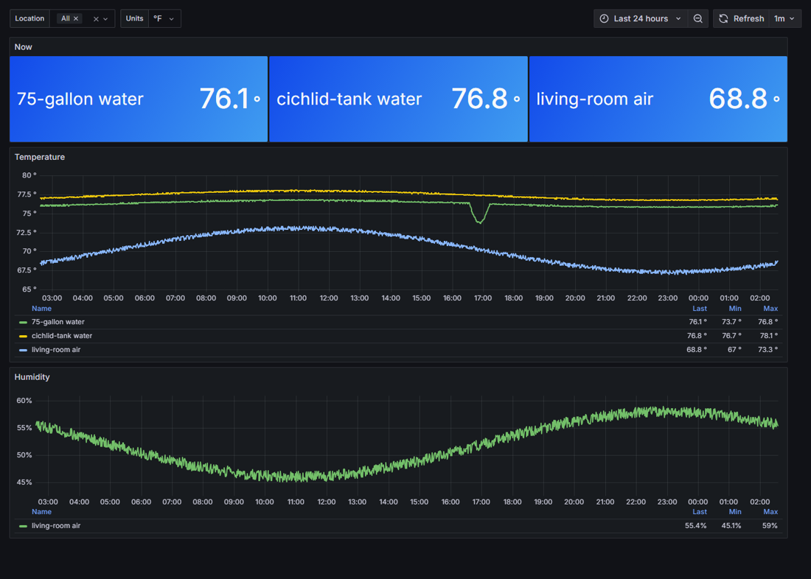
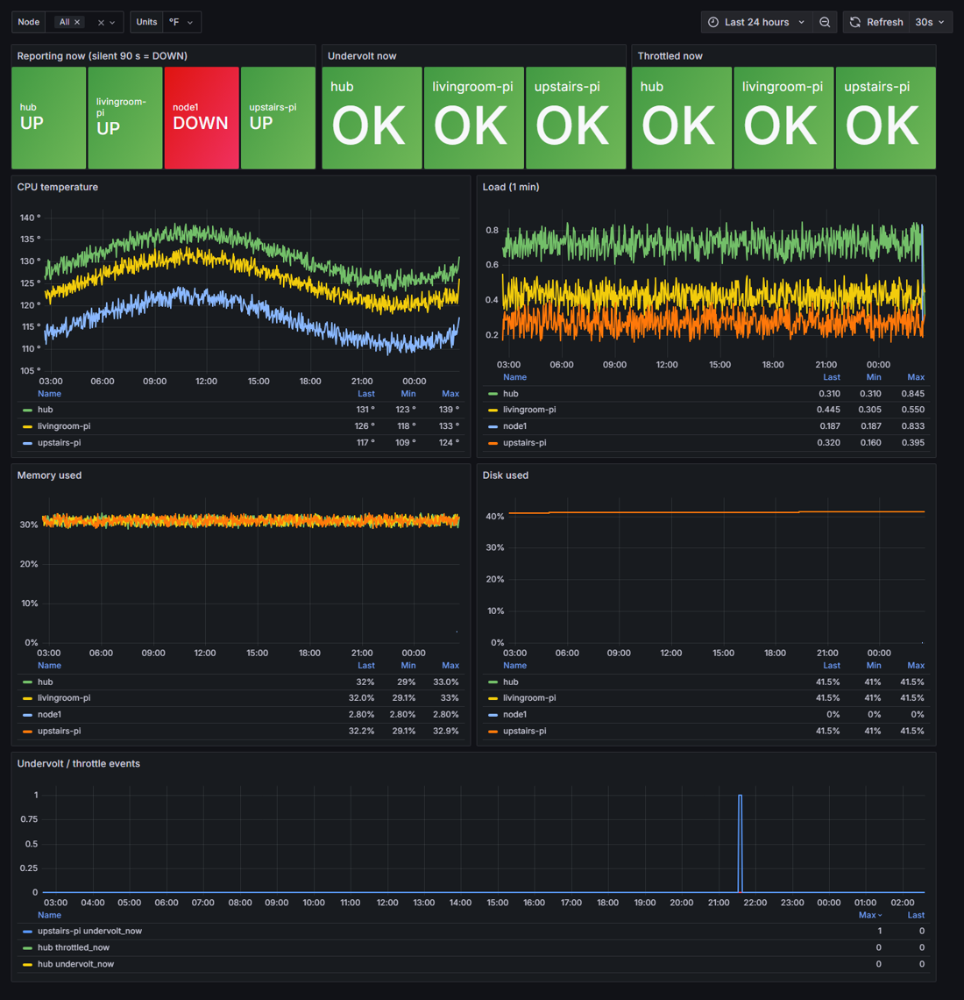

# TankWatch

**Tracking anything you can buy an open sensor for.**

TankWatch started as a way to watch three fish tanks with Raspberry Pis. It works for anything a cheap,
open sensor can measure: aquariums, house plants, a pet feeder's food level, a room, a garage freezer.
You get the same kind of live dashboards and history that commercial aquarium controllers charge hundreds
of dollars for, on hardware you already own, with no subscription and no cloud account.

```
 sensor Pis (nodes)                          hub (one Pi 5, or any Linux box)
 ┌──────────────────────┐                     ┌──────────────────────────────┐
 │ tankwatch-node       │   readings, every   │ InfluxDB  ← stores history   │
 │  • DS18B20 water °F  │ ──────────────────► │ Grafana   ← dashboards       │
 │  • DHT11 air/humidity│   30–60 s (HTTP)    │                              │
 │  • the Pi's health   │                     │ both in Docker               │
 └──────────────────────┘                     └──────────────────────────────┘
```

- **Everything runs in Docker.** One command sets up the hub; one command starts each sensor node.
- **Sensors are plug-ins.** Each node lists its sensors in a short `config.yaml`. Adding a new kind of
  sensor is one small Python file; see [docs/adding-a-sensor.md](docs/adding-a-sensor.md).
- **Built for reliability.** Nodes keep readings in memory while the hub is unreachable and send them when it
  comes back. Every node also reports its own health (CPU temperature, Raspberry Pi undervolt and throttle
  warnings, memory, disk), so you know when a sensor box is the problem, not the tank.
- **Least-privilege tokens.** Nodes get a write-only token; Grafana gets a read-only one. A lost sensor Pi
  can't read or delete your history.
- **°F or °C.** Every temperature is stored in both; dashboards have a units switch.
- **A status sign that tells you when a collector is down.** You don't have to open a dashboard to know
  something's wrong. See below.





*The two dashboards that come with TankWatch, shown with 24 hours of sample data: two tanks and a room,
with a water change around 17:00, and three collectors plus one that has gone silent (DOWN).*

## The status sign: alerting you can see from across the room

A dashboard only helps if you look at it. TankWatch drives an inexpensive LED matrix sign (Pimoroni Galactic
Unicorn) that sits on a shelf and shows every collector's state by colour:


*The real sign. The third collector has gone silent, so its block is red, and the humidity shown is that
collector's last reading, drawn in grey because it's stale. The camera washes the grey out to white.*

| Colour | Meaning |
|---|---|
| 🟢 Green | The collector is reporting normally |
| 🟡 Amber | It's reporting, but something's wrong: undervoltage, CPU throttling, or running hot |
| 🔴 Red | **The collector has gone silent.** No report for 90 seconds. It has crashed, lost power, or dropped off the network |

The sign reads straight from the hub's database with its own read-only token. If the hub itself stops
answering, the sign falls back to checking each Pi directly over the network. That way a dead hub can't
make every collector look healthy. Between alerts it rotates through the latest readings (water and air
temperature, humidity), so it earns its shelf space.

This matters most for the failure people don't think about. When a sensor box dies, the tank is fine, but
you've stopped watching it. Without the sign, you find out days later from a gap in a graph. With it, you
find out the next time you walk past.

Setup, buttons and the styles it can show (including a Road Rash race against your collectors) are in
[sign/README.md](sign/README.md). Which collectors and readings it shows is one small `config.json`.

## What you need

| Part | For | Roughly |
|---|---|---|
| Raspberry Pi 5 (4 GB or more) or any 64-bit Linux computer | The hub | You may already have one |
| Any Raspberry Pi (3B+ or newer, or a Zero 2 W) | Each collector | $15–60 |
| DS18B20 waterproof probe + 4.7 kΩ resistor | Water temperature | $3–10 |
| DHT11 or DHT22 | Air temperature and humidity | $2–10 |
| Jumper wires, a reliable power supply per Pi | | |
| Pimoroni Galactic Unicorn (Pico 2 W version) | The status sign (optional) | |

One Pi can be both the hub and a collector.

## Quick start

### 0. Install Docker on each Pi

Use 64-bit Raspberry Pi OS (Bookworm or newer). Then:

```sh
curl -fsSL https://get.docker.com | sh
sudo usermod -aG docker $USER    # then log out and back in
```

### 1. The hub

```sh
git clone https://github.com/MT3chn1k/tankwatch.git
cd tankwatch/hub
./setup.sh
```

`setup.sh` creates random passwords and tokens in `hub/.env`, starts InfluxDB and Grafana, and prints the
lines each collector needs. Open Grafana at `http://<hub-ip>:3000` with the user and password it printed.

### 2. A collector (sensor node)

```sh
git clone https://github.com/MT3chn1k/tankwatch.git
cd tankwatch/node
cp .env.example .env                 # paste the lines setup.sh printed, and name this collector
cp config.example.yaml config.yaml   # list this collector's sensors and where they are
nano docker-compose.yml              # uncomment the hardware lines for your sensors
docker compose up -d --build
docker logs -f tankwatch-node        # watch the readings go out
```

- **No sensors wired yet?** Use `type: mock` in `config.yaml` to send fake readings and see the dashboards work.
- **A sensor that isn't wired or answering doesn't stop the others.** The log says "could not start" and what to
  check, and the collector retries it every 5 minutes.
- **Using the status sign?** The collector's name (`TANKWATCH_NODE` in `.env`) is what you list in the sign's
  `config.json`.
- **Prefer no Docker on the collector?** See [docs/install-node.md](docs/install-node.md).

### 3. Keep it running

`hub/backup.sh` backs up every reading and dashboard, and `hub/restore.sh` puts them back. Backups,
upgrades, security and troubleshooting are in [docs/operating-the-hub.md](docs/operating-the-hub.md).

## Supported sensors

| `type:` | What it measures | Hardware | Notes |
|---|---|---|---|
| `ds18b20` | Water / liquid temperature | DS18B20 waterproof probe + 4.7 kΩ resistor | Several probes can share one pin. [Wiring](docs/wiring/ds18b20-wiring.svg) |
| `dht` | Air temperature + humidity | DHT11 or DHT22 | [Wiring](docs/wiring/dht11-wiring.svg) |
| `node_health` | The Pi itself | none | CPU temp, undervolt/throttle, voltages, load, memory, disk |
| `mock` | Fake data | none | For testing |

Planned: pH and conductivity/TDS (Atlas Scientific EZO), soil moisture for plants, distance sensors for
feeder and reservoir levels, water-leak detection. Adding one: [docs/adding-a-sensor.md](docs/adding-a-sensor.md).
To build your own panels and alerts, see [docs/data-model.md](docs/data-model.md) for what's stored and example
queries.

## Project status

TankWatch grew out of a working home setup: Raspberry Pi collectors and a Pi 5 hub built to watch three
aquariums, with the status sign on a shelf. The packaged version here is new. What's been tested so far:

| Part | Tested on |
|---|---|
| Hub setup, dashboards, backup and restore | Docker on a PC, from a fresh clone |
| Collector agent in Docker | Docker on a PC, with the `mock` and `node_health` sensors |
| `ds18b20` and `node_health` sensor code | A Raspberry Pi 3B+ with a real probe |
| `dht` sensor code | The same logic runs the home setup's DHT11s, but not yet from inside the Docker container |
| Status sign | This version: its screens and shows on a PC simulator against a real hub. The original, home-specific version it came from runs the real sign every day |
| Hub on a Raspberry Pi 5 in Docker | Not yet: the home hub runs the same InfluxDB and Grafana without Docker |

If you try a combination that isn't in this list, please open an issue with what worked and what didn't.

## Roadmap

- [x] Containerized hub and sensor node, plug-in sensors, store-and-forward, node health
- [x] **Status sign** (Pimoroni Galactic Unicorn): green / amber / red per collector, red when one goes silent
- [ ] Alerts (Grafana alerting to email / phone) with sensible defaults per sensor
- [ ] pH, TDS, soil moisture, level sensors
- [ ] Network traffic mapping per node (NetFlow)
- [ ] Automated nightly backups of every node and the hub, with monthly archives
- [ ] Integrations: smart lighting, wearables

## License

MIT. See [LICENSE](LICENSE).
