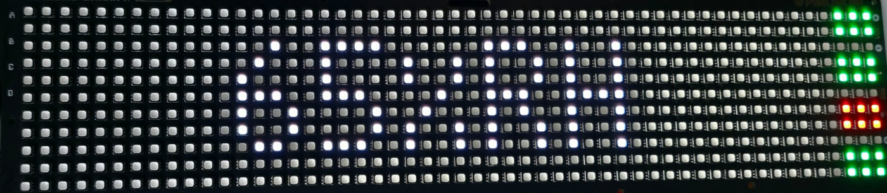
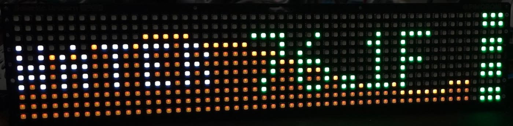
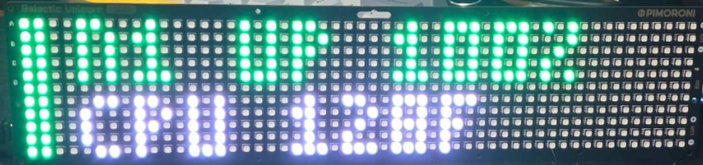

# TankWatch status sign

A Pimoroni **Galactic Unicorn** (53×11 LED matrix with a Raspberry Pi Pico 2 W) that sits on a shelf and
tells you, without opening anything, whether every collector is alive and what your readings are.



*The real sign. The third collector has gone silent, so its block is red, and the humidity shown is that
collector's last reading, drawn in grey because it's stale. The camera washes the grey out to white.*

## What it shows

**Right edge: one status block per collector** (up to four, top to bottom in `config.json` order):

| Block | Meaning |
|---|---|
| 🟢 Green | Reporting normally |
| 🟡 Amber | Reporting, but undervolted, throttled, or CPU hotter than `hot_cpu_c` |
| 🔴 Red | **Silent for 90 seconds.** Crashed, unplugged, or off the network |
| ⚫ Grey | Not checked yet, or the hub is down and this collector has no `address` to check directly |

If the hub itself stops answering, its block goes red and the sign checks the other collectors directly
(does the Pi answer on port 22?). That way a dead hub can't make the collectors look healthy, or make all of
them look dead.



*The standard WATER readout with its one-hour trend and four green status blocks. Sample values, staged for the photo.*

**Main area: rotating readouts** with a faint one-hour trend graph behind each one:
AIR temperature, WATER temperature, humidity, and a scrolling 24-hour uptime per collector. Colours follow
`air_range_f` / `water_range_f`: blue below, green inside, orange above. A reading older than 15 minutes
turns grey and blinks its age.



*The Road Rash style (button C): a pit-board card for a collector you've just passed. Sample values, staged for the photo.*

**Buttons**

| Button | Does |
|---|---|
| A | Air temperature (press again for water) |
| B | Humidity |
| C | Road Rash: a race against your collectors, reporting uptime, CPU temps and readings |
| D | 1990s demoscene loop showing collector health |
| Volume ± | Step through styles: 1 standard, 2 Road Rash, 3 demo, 4 synthwave sunset drive (kept across reboots) |
| Brightness ± | Brightness |
| Zzz | Display off / on |

## Setup

You need: a Galactic Unicorn (Pico 2 W version), a USB cable to its **Pico's micro-USB port**, and Python
on your computer (`pip install mpremote`).

1. **Flash Pimoroni's MicroPython** for the Galactic Unicorn (Pico 2 W build) from
   <https://github.com/pimoroni/unicorn>, following their instructions.
2. **Make a read-only token.** Use the hub's `INFLUX_READ_TOKEN` from `hub/.env`. Never give the sign
   a write token; it only needs to read.
3. **Write the two settings files** in this folder:
   ```sh
   cp secrets.example.py secrets.py       # Wi-Fi name and password, read-only token
   cp config.example.json config.json     # hub address, collectors, locations, colour ranges
   ```
   In `config.json`, each collector's `name` must match the name it reports (`TANKWATCH_NODE` in its `.env`, or
   its host name). `label` is what the sign prints; keep it to three characters.
4. **Run a collector on the hub machine too** (just `node_health`), so the hub gets its own status block.
5. **Copy everything to the sign** (plug into the Pico's micro-USB, not the board's edge port):
   ```sh
   mpremote cp main.py demo.py roadrash.py synthwave.py config.json secrets.py :
   mpremote reset
   ```
   It shows HELLO, joins Wi-Fi, and has data within a minute.

## Things that will bite you

- **Never overclock** (`machine.freq(...)`). The Pico 2 W's Wi-Fi chip fails and the sign freezes on HELLO.
- **Wi-Fi must start before `GalacticUnicorn()` is created.** `main.py` already does this. Keep the order if you
  change it.
- If the sign freezes on HELLO or shows `WIFI ERR`, do a **hard reset** (`mpremote exec "import machine; machine.reset()"`
  or unplug it). A soft reboot keeps the Wi-Fi chip in its bad state.
- `mpremote cat :log.txt` stops the running program; reset afterwards. The log keeps the last ~8 KB of
  connection and status changes.

## Previewing on your computer

`tools/` runs the sign's code on a PC with fake hardware (needs `pip install pillow`):

```sh
python tools/sim_main.py config.json <read-only-token> screens.png   # real hub, standard screens
python tools/sim_rash.py rash.png                                    # Road Rash, sample data
python tools/sim_demo.py demo.png                                    # demoscene, sample data
```

Fonts are approximated, so check text placement on the real board. `tools/*_bench.py` time each show on the
board itself (`mpremote run tools/demo_bench.py`).
